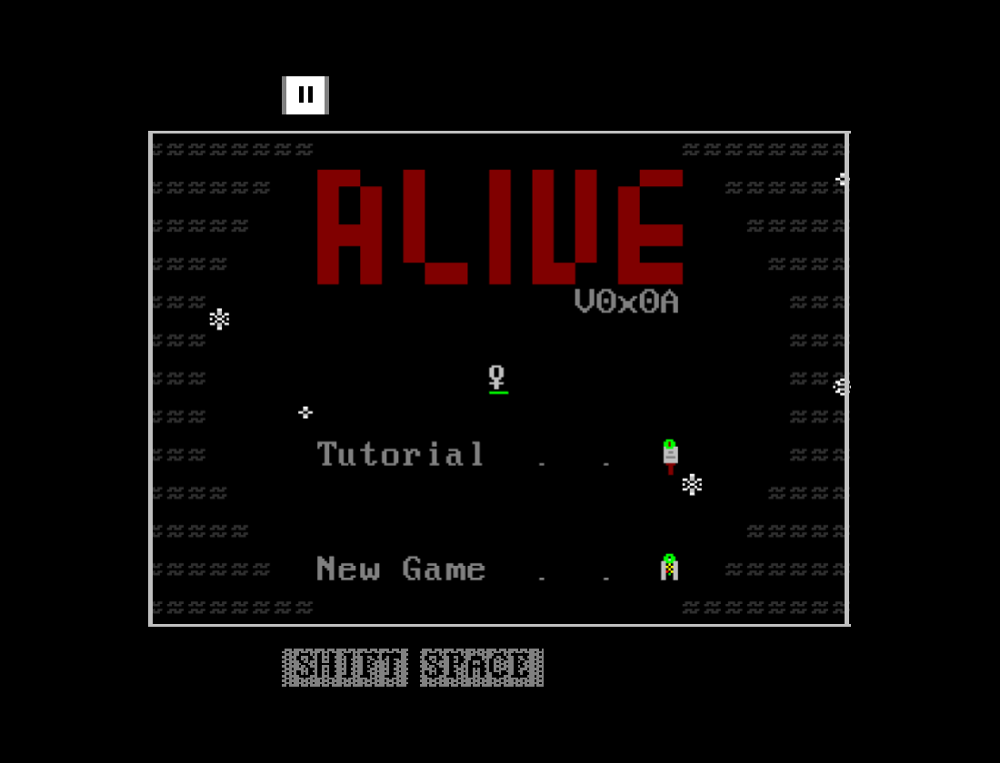

# Alive

A browser adventure game made from layered DOS characters and sixteen terminal colors. Built with TypeScript, React, Three.js, and an entity component system.

[Play](https://ab-und-zu.github.io/alive/) · [HTML](https://ab-und-zu.github.io/alive/html/) · [Web Terminal](https://ab-und-zu.github.io/alive/terminal/) · [Wiki](https://ab-und-zu.github.io/alive/wiki/)



## Run locally

```sh
npm ci
npm start
```

The default renderer uses Three.js. Open `http://localhost:3000/alive/html/` for the HTML/SVG renderer, with the same controls and fog of war but no lighting or shadows.

Open `http://localhost:3000/alive/terminal/` for the web Terminal client. It uses a simplified character grid and keyboard controls, with fog of war but no lighting or shadows.

```sh
npm run terminal
```

The terminal renderer also runs over SSH. Use UTF-8 and true color, with at least 33 columns and 24 rows. Ctrl-C saves and exits. See [terminal controls and saves](src/renderers/terminal/index.md).

## Read and preview the wiki

Player wiki lives in [wiki/](wiki/index.md). Technical notes live beside the source files they explain. Both appear as separate chapters in the generated site.

```sh
npm run wiki:dev
```

Open http://127.0.0.1:4173. Edits rebuild and reload the preview automatically. `npm run wiki:build` writes a static site to `.wiki-build/`. See [wiki tools](src/wiki/index.md) for Markdown authoring, imported examples, browser checks, and GitHub Pages deployment.

Wiki builds and previews reuse the committed minimap snapshot. Run `npm run wiki:minimap` only when you want to regenerate it, then review and commit `src/wiki/minimap.json`.

## Development

Start with the [development guidelines](AGENTS.md). Check assumptions against the code, tests or running game. Find the closest example in the code and Development wiki, then make the smallest change that fits the local style. Build every visible game and wiki element from existing DOS characters and stacked sprites. Never add custom CSS or new rendering machinery.

Verify the affected behavior in your worktree. Follow the [merge checks](AGENTS.md#verification) when integrating into local `main`. The [game test guide](src/testing/harness.md) shows how to run one feature file.

## Version bumps

After changing the package version, run `npm run media:titles` to regenerate the transparent `media/title-*.png` images. Requires ImageMagick 7 (`magick`). The script uses the bundled DOS font, game colors, and cell proportions.

Also capture a fresh [in-game title screen](media/game.png) with the new version visible. Save it as `media/game.png` alongside the other media assets, and inspect both the screenshot and regenerated title images.
