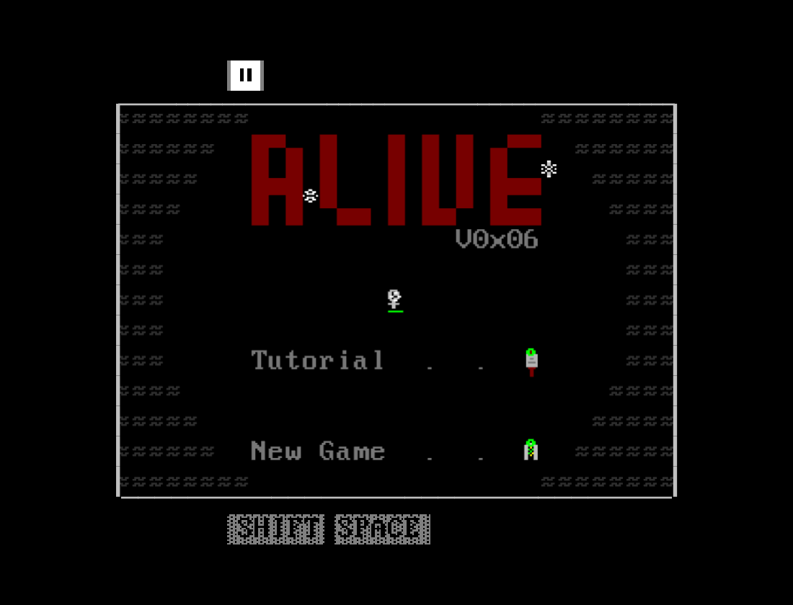

# Alive

A browser adventure game made from layered DOS characters and sixteen terminal colors. Built with TypeScript, React, Three.js, and an entity component system.

[Play](https://ab-und-zu.github.io/alive/) · [Wiki](https://ab-und-zu.github.io/alive/wiki/)



## Run locally

```sh
npm ci
npm start
```

## Read and preview the wiki

Player wiki lives in [wiki/](wiki/index.md). Technical notes live beside the source files they explain. Both appear as separate chapters in the generated site.

```sh
npm run wiki:dev
```

Open http://127.0.0.1:4173. Edits rebuild and reload the preview automatically. `npm run wiki:build` writes a static site to `.wiki-build/`. See [wiki tools](src/wiki/index.md) for Markdown authoring, imported examples, browser checks, and GitHub Pages deployment.


## Development

Read [AGENTS.md](AGENTS.md) before editing. Reuse the local style and game helpers, keep code easy to follow, and verify every change.

```sh
npm run check:fast
npm run test:slow
npm run build
npx playwright install chromium
npm run wiki:test
```

Fast checks cover types, lint, and small feature tests. `test:slow` checks game integration and rendering; `test:all` runs both test groups. The pre-commit hook runs lint only, so run the checks above before committing code changes. The wiki browser suite checks live examples, navigation, and responsive layout.

Run `npm run test:generation` only when changing level generation or generation-dependent fixtures. CI uses `npm run test:ci` to run game and generation tests together, report coverage and enforce the thresholds in `package.json`.

## Version bumps

After changing the package version, run `npm run media:titles` to regenerate the transparent `media/title-*.png` images. Requires ImageMagick 7 (`magick`). The script uses the bundled DOS font, game colors, and cell proportions.

Also capture a fresh [in-game title screen](media/game.png) with the new version visible. Save it as `media/game.png` alongside the other media assets, and inspect both the screenshot and regenerated title images.
