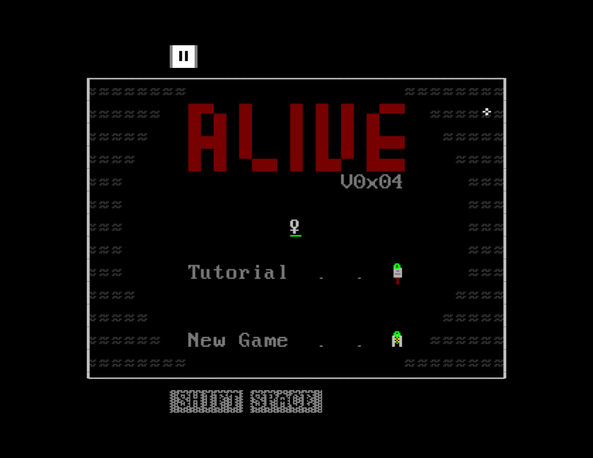

# Alive field guide

A small adventure inside a terminal. Explore a world made from stacked characters, find equipment, and learn what each spell does to the things around you.

[Start with the controls](controls.md), then follow the signs in the Dungeon. The Island opens up after the tutorial.



## In this guide

- [Controls](controls.md): move, interact, use items, and read menus.
- [World](world.md): the Dungeon, Island, fog, water, and buildings.
- [Combat](combat.md): swords, spells, skills, and elemental effects.
- [Gear and life](gear.md): classes, stats, food, potions, and death.
- [Gathering](gathering.md): tools, crops, and fishing.
- [Making things](making.md): crafting, brewing, forging, and building.

## Try an example

Press **Play** for one step, **Auto** to keep going, and **Reset** to return to the start. Auto changes to **Pause** while running. Examples stop when they leave the screen or the browser tab is hidden.

```scene
movement
```

The small worlds use the game's systems and sprite layers, drawn in HTML. Reference examples show current game data. They do not spend items or change your game.

## What is available

This guide describes the current browser game. Normal class selection offers Rogue. The Dungeon and Island are implemented. Other class definitions and a larger set of equipment exist in the code, but that does not mean everything can be found in an ordinary run.

Multiplayer realms, tribe campaigns, and several worlds in the design PDF are plans. There is no save system in the current game; reloading starts a new session.

## About this guide

The reference is **alive_Docs.pdf**, especially its short feature descriptions, sprite examples, and terminal style. Current code takes precedence where the design has changed. The [research notes](../src/documentation/scenes.md) list the sources checked and visual inspection evidence.

Development chapters explain the [engine](../src/engine/ecs.md), [world creation](../src/bindings/creation.md), [rendering](../src/components/Row/index.md), [tests](../src/testing/harness.md), and [documentation tools](../src/documentation/index.md).
